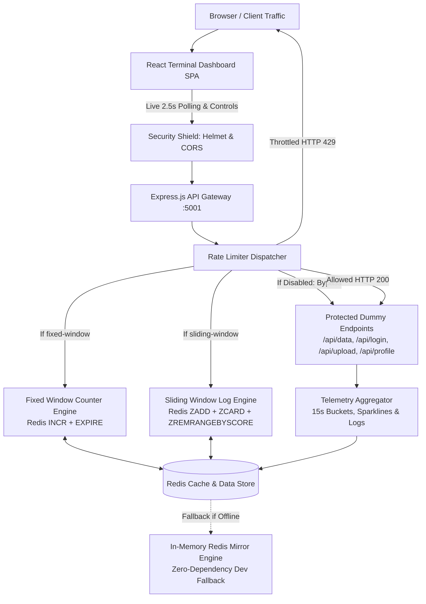

# ⚡ Pressure Meter (API Rate Limiter Gateway)

> **SAME API. A HEALTHIER INTERNET.**  
> *A full-stack API Rate Limiter Gateway with an Aquamorphic Living Flow frosted-glass dashboard, contrasting uncontrolled traffic chaos with resilient, rate-limited infrastructure.*

---

## 📸 Overview & Dashboard Preview

**Pressure Meter** visually proves the critical importance of API rate limiting in production systems. By contrasting an unthrottled API (vulnerable to cascading failures, service outages, and volumetric abuse) with a rate-limited API (maintaining strict throughput quotas and bounded latency), developers can interactively test, observe, and benchmark rate limiting algorithms against real traffic bursts.

All counters, sparklines, 15-second activity histograms, and recent request logs stream from **real Redis state**—zero simulated or hardcoded metrics.

---

## 🏗️ Architecture & Data Flow



---

## ⚖️ Algorithmic Comparison & Trade-Offs

Pressure Meter implements both industry-standard algorithms, allowing real-time switching via the dashboard console:

| Feature / Metric | Fixed Window Counter (`fixed-window`) | Sliding Window Log (`sliding-window`) |
|---|---|---|
| **Redis Primitive** | `INCR` + `EXPIRE` | `ZADD`, `ZREMRANGEBYSCORE`, `ZCARD` |
| **Data Structure** | Integer String (`ratelimit:fixed:{ip}:{window}`) | Sorted Set (`ratelimit:sliding:{ip}`) |
| **Time Complexity** | $\mathcal{O}(1)$ per request | $\mathcal{O}(\log M + M)$ where $M$ is expired entries |
| **Space Complexity** | $\mathcal{O}(1)$ (single integer counter) | $\mathcal{O}(N)$ where $N$ is requests in window |
| **Boundary Burst Vulnerability** | ⚠️ **Vulnerable:** Up to $2\times$ the limit can burst across window boundaries | 🛡️ **Immune:** Continuous time window prevents boundary clustering |
| **Ideal Use Case** | High-throughput, resource-constrained services where approximate rate control suffices | Financial APIs, login/auth endpoints, abuse mitigation, strict QoS |

---

## 🛡️ Security Hardening & Vulnerability Mitigation

To ensure production-grade security, the application incorporates defensive hardening across all layers:
- **DDoS & Volumetric Abuse Protection:** Pre-routing rate limiting rejects malicious surges with HTTP `429 Too Many Requests` and standard `Retry-After` headers.
- **OWASP Header Hardening:** `helmet` sets strict `Content-Security-Policy`, `X-Frame-Options: DENY` (anti-clickjacking), `X-Content-Type-Options: nosniff`, and strips `X-Powered-By`.
- **JSON Memory Bomb Defense:** `express.json({ limit: '10kb' })` strictly caps request payload size, preventing memory exhaustion attacks.
- **Strict Input Validation:** Control endpoints enforce type safety (e.g. `/api/limit` requires integers between 10 and 1000; `/api/algorithm` is whitelist-checked).
- **Redis Command Safety:** 100% parameterized queries eliminating command injection vectors.
- **Redis Memory Capping:** Log lists are strictly capped at 50 items using atomic `LTRIM`, and all rate limiting keys have strict `EXPIRE` TTLs.
- **Safe Client IP Resolution:** `trust proxy` configuration prevents header spoofing in reverse-proxied environments.
- **Information Masking:** Production error handlers strip internal stack traces and server details.

---

## 🛠️ Tech Stack

- **Backend:** Node.js, Express.js, `ioredis`, `helmet`, `cors`, `dotenv`
- **Rate Limiting Engine:** Redis (with automatic zero-dependency in-memory fallback mirror)
- **Frontend:** React, Vite, Vanilla CSS Design System with CSS variables
- **Typography:** `Space Grotesk` (Headings) & `JetBrains Mono` (Tabular Data & Logs)
- **Icons:** Custom SVGs and `lucide-react`
- **Aesthetic:** ColorOS 17 Aquamorphic Living Flow Glassmorphism, radiant twilight aurora orbs, crystal frosted acrylic surfaces, tactile spring micro-interactions

---

## 🚀 Local Setup & Installation

### Prerequisites
- Node.js (>= v18, tested on v24)
- npm (>= v9)
- Redis *(Optional — if Redis is not running locally, the backend automatically engages its built-in in-memory Redis mirror)*

### 1. Clone Repository
```bash
git clone https://github.com/your-username/pressure-meter.git
cd pressure-meter
```

### 2. Backend Setup
```bash
cd backend
npm install
cp .env.example .env

# Run automated test suite
npm test

# Start backend server (Port 5001)
npm start
```

### 3. Frontend Setup
```bash
# In a new terminal window
cd ../frontend
npm install
cp .env.example .env

# Start frontend development server (Port 5173)
npm run dev
```

Open [http://localhost:5173](http://localhost:5173) in your browser.

---

## 📡 API Endpoint Reference

| Method | Endpoint | Description | Rate Limited |
|---|---|---|---|
| `GET` | `/api/status` | System health, Redis status, uptime, last check | No |
| `GET` | `/api/stats` | Cumulative requests, blocked, success, avg latency | No |
| `GET` | `/api/logs` | Last 8–10 recent request log records | No |
| `GET` | `/api/activity` | 5-minute traffic grouped into 15s stacked buckets | No |
| `POST` | `/api/toggle` | Toggles rate limiting ON / OFF | No |
| `POST` | `/api/algorithm` | Switch algorithm (`fixed-window` / `sliding-window`) | No |
| `POST` | `/api/limit` | Update request quota threshold (10–1000 req/min) | No |
| `POST` | `/api/send-burst` | Simulates 20 concurrent requests against protected API | No |
| `GET` | `/api/data` | Protected dummy telemetry data | **Yes** |
| `POST` | `/api/login` | Protected dummy authentication endpoint | **Yes** |
| `POST` | `/api/upload` | Protected dummy file upload endpoint | **Yes** |
| `GET` | `/api/profile` | Protected dummy user profile endpoint | **Yes** |

---

## 🌐 Deployment Targets

- **Backend:** [Render](https://render.com) (Node.js Web Service)
- **Redis Cache:** [Upstash](https://upstash.com) (Serverless Redis)
- **Frontend:** [Vercel](https://vercel.com) (Vite React SPA)

---

## 📄 License
MIT © Antigravity Engineering
