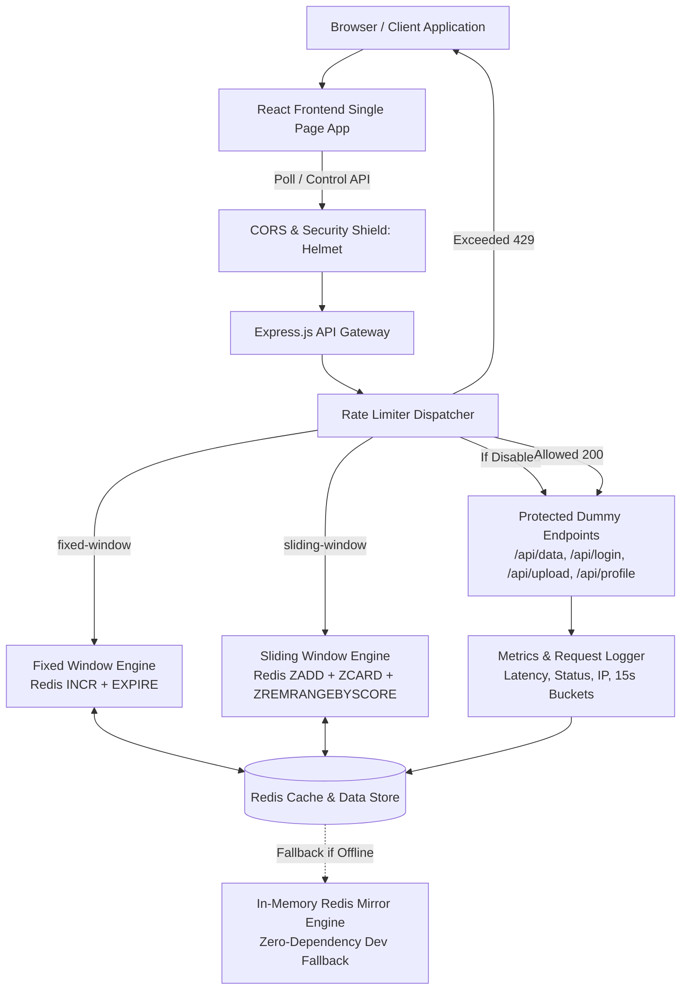

# Technical Requirements Document (TRD)
## Project Name: Pressure Meter (API Rate Limiter Gateway Demo)
**Version:** 1.0.0  
**Status:** Approved  
**Author:** AI Pair Programmer & Lead Engineering  

---

## 1. System Architecture

### 1.1 High-Level Architecture Diagram

---

## 2. Technology Stack & Package Decisions

### 2.1 Backend Architecture
- **Runtime:** Node.js (>= v20 LTS, running on v24)
- **Framework:** Express.js (`express` v4.x)
- **Redis Client:** `ioredis` (v5.x)
  - *Why ioredis?* Full cluster/sentinel support, built-in reconnection pipeline, superior performance, Promise-based API, support for sorted sets and Lua scripts.
- **Security & Middleware Packages:**
  - `helmet`: Automatically sets secure HTTP headers (CSP, HSTS, X-Content-Type-Options, etc.).
  - `cors`: Explicit CORS domain whitelisting.
  - `express-rate-limit`: Optional defense-in-depth safety net for internal control endpoints.
  - `dotenv`: Secure environment variable management.
- **Development Tooling:** `nodemon` for hot reload.

### 2.2 Frontend Architecture
- **Framework:** React 19 / 18
- **Build Tool:** Vite 6 / 5
  - *Why Vite?* Instant HMR, minimal bundle footprint, native ES modules.
- **Styling:** Vanilla CSS with custom CSS variables (Design Tokens), zero heavy CSS framework overhead, fine-grained control over terminal CRT and glow aesthetics.
- **Data Visualization & Charts:**
  - Chart.js + `react-chartjs-2` or lightweight custom SVG / Recharts for the 15-second stacked traffic bucket chart.
  - Custom zero-dependency SVG sparklines inside stat cards for maximal performance.
- **Icons:** `lucide-react` (terminal, shield, alert, activity, cpu, server icons).
- **Fonts:** Google Fonts CDN:
  - Space Grotesk (`https://fonts.googleapis.com/css2?family=Space+Grotesk:wght@600;700&display=swap`)
  - JetBrains Mono (`https://fonts.googleapis.com/css2?family=JetBrains+Mono:wght@400;500;700&display=swap`)

---

## 3. Rate Limiting Algorithms Deep-Dive & Implementation

### 3.1 Algorithm 1: Fixed Window Counter
- **Mechanism:**
  - Quantizes time into discrete windows: `windowIndex = Math.floor(currentTimeMs / (windowSizeSeconds * 1000))`.
  - Redis Key: `ratelimit:fixed:{ip}:{windowIndex}`.
  - On each incoming request:
    1. Executes `INCR` on the key.
    2. If the resulting count is `1` (new window), sets `EXPIRE` equal to `windowSizeSeconds + 5` (grace period for network latency).
    3. If count `<= limit`: Allows request with headers:
       - `X-RateLimit-Limit: <limit>`
       - `X-RateLimit-Remaining: <limit - count>`
       - `X-RateLimit-Reset: <windowEndTime>`
    4. If count `> limit`: Rejects request immediately with HTTP `429 Too Many Requests`:
       - `Retry-After: <secondsUntilNextWindow>`
- **Trade-offs:**
  - **Memory:** $O(1)$ per client IP per window. Extremely low memory footprint.
  - **CPU:** $O(1)$ single atomic increment.
  - **Vulnerability (Boundary Burst):** Up to $2 \times \text{limit}$ requests can be accepted within a short duration if sent across window boundaries (e.g. 100 requests at 00:59 and 100 requests at 01:00).

### 3.2 Algorithm 2: Sliding Window Log
- **Mechanism:**
  - Redis Data Structure: Sorted Set (`ZSET`).
  - Redis Key: `ratelimit:sliding:{ip}`.
  - Member: Unique identifier (`${timestampMs}:${uuid}`).
  - Score: Unix timestamp in milliseconds (`timestampMs`).
  - On each incoming request (atomic pipeline or Lua script):
    1. `ZREMRANGEBYSCORE ratelimit:sliding:{ip} 0 (currentTimeMs - windowSizeMs)` (purge old requests outside the sliding 60-second window).
    2. `ZCARD ratelimit:sliding:{ip}` (fetch current active count in window).
    3. If `currentCount < limit`:
       - `ZADD ratelimit:sliding:{ip} currentTimeMs uniqueMember`.
       - `EXPIRE ratelimit:sliding:{ip} (windowSizeSeconds + 10)`.
       - Allow request.
    4. If `currentCount >= limit`:
       - Calculate time until oldest member expires to yield exact `Retry-After`.
       - Reject with HTTP `429 Too Many Requests`.
- **Trade-offs:**
  - **Memory:** $O(N)$ where $N$ is the number of requests per window.
  - **CPU:** $O(\log M + M)$ where $M$ is expired entries.
  - **Accuracy:** 100% immune to boundary burst attacks. Smooth, continuous rate control.

---

## 4. Security Hardening & Vulnerability Mitigation Architecture

To fulfill the explicit requirement to make the system **hackproof and resilient against modern web vulnerabilities**, the following defensive measures are baked into every layer:

### 4.1 Denial of Service & Resource Exhaustion Defense
1. **Dynamic Rate Limiting Shield:** All incoming requests to protected routes pass through the rate limiter before triggering business logic or database queries.
2. **Control Route Self-Protection:** Control endpoints (`/api/send-burst`, `/api/reset`, `/api/limit`) are protected with strict burst caps to prevent an attacker from abusing the burst simulator itself to DoS the backend.
3. **Payload Size Guard:** Enforce `express.json({ limit: '10kb' })` to reject oversized payloads before parsing, mitigating JSON parsing memory bomb attacks.
4. **Redis Bounded Memory Capping:**
   - Log list `ratelimit:logs` is strictly bounded to the last 50 elements using atomic `LPUSH` + `LTRIM`.
   - All rate limiter keys have an explicit `EXPIRE` time, preventing memory leaks and Redis eviction cascades.

### 4.2 Web Security & HTTP Headers (OWASP Hardening)
1. **Helmet.js Configuration:**
   - `Content-Security-Policy`: Restricts scripts and styles to self and vetted CDNs (Google Fonts).
   - `X-Frame-Options: DENY`: Prevents Clickjacking attacks in malicious iframes.
   - `X-Content-Type-Options: nosniff`: Prevents MIME-type confusion attacks.
   - `Strict-Transport-Security`: Enforces HTTPS in production.
   - `X-XSS-Protection`: Legacy protection for older browsers.
   - Remove `X-Powered-By` header to avoid information disclosure.
2. **Strict CORS Policy:**
   - In production, CORS restricts requests strictly to the verified frontend domain.
   - In development, restricted to `http://localhost:5173` and local network interfaces.

### 4.3 Input Validation & Sanitization
1. **Schema Validation on Control Endpoints:**
   - `/api/limit`: Validates that `limit` is a safe integer between 10 and 1,000. Rejects negative numbers, floating points, and strings with `400 Bad Request`.
   - `/api/algorithm`: Validates input against an explicit whitelist `['fixed-window', 'sliding-window']`.
   - `/api/toggle`: Validates that `enabled` is strictly boolean.
2. **Safe Client IP Resolution (Preventing IP Spoofing):**
   - Configures Express `app.set('trust proxy', 1)` when behind reverse proxies (Render/Cloudflare).
   - Validates that the resolved IP is a well-formed IPv4 or IPv6 address. Prevents header manipulation in `X-Forwarded-For` from poisoning Redis key namespaces.

### 4.4 Redis Command Safety
- Direct parameterization of all Redis keys and values.
- Zero string concatenation into raw Redis commands or Lua scripts, eliminating any possibility of Redis command injection.

### 4.5 Production Error Handling
- Global Express error handling middleware traps all exceptions.
- In production, internal error details, stack traces, and database connection strings are masked from client responses.

---

## 5. API Data Models & Schemas

### 5.1 Endpoints Specification

| Method | Endpoint | Description | Rate Limited? | Auth? |
|---|---|---|---|---|
| `GET` | `/api/data` | Dummy telemetry data | Yes | No |
| `POST` | `/api/login` | Mock authentication | Yes | No |
| `POST` | `/api/upload` | Mock file upload | Yes | No |
| `GET` | `/api/profile` | Mock profile data | Yes | No |
| `POST` | `/api/toggle` | Toggles rate limiting | No (Protected) | No |
| `POST` | `/api/algorithm` | Switch algorithm | No (Protected) | No |
| `POST` | `/api/limit` | Update limit (10-1000) | No (Protected) | No |
| `POST` | `/api/send-burst`| Fire 20 mock requests | No (Bounded) | No |
| `GET` | `/api/stats` | Aggregated counters | No | No |
| `GET` | `/api/activity` | 5-min 15s bucket data | No | No |
| `GET` | `/api/logs` | Last 8-10 requests | No | No |
| `GET` | `/api/status` | System health & uptime | No | No |

### 5.2 Redis Data Schema

| Redis Key | Type | Description | TTL |
|---|---|---|---|
| `ratelimit:fixed:{ip}:{window}` | `STRING` (Int) | Request counter for fixed window | Window + 5s |
| `ratelimit:sliding:{ip}` | `ZSET` | Timestamps of requests in sliding window | Window + 10s |
| `ratelimit:config:enabled` | `STRING` | Global rate limiter switch (`true`/`false`) | Persistent |
| `ratelimit:config:algorithm` | `STRING` | Active algorithm name | Persistent |
| `ratelimit:config:limit` | `STRING` | Active request limit threshold | Persistent |
| `ratelimit:logs` | `LIST` | JSON objects of recent requests (capped at 50) | Persistent |
| `ratelimit:stats:total` | `STRING` (Int) | Cumulative requests processed | Persistent |
| `ratelimit:stats:blocked` | `STRING` (Int) | Cumulative requests blocked (429) | Persistent |
| `ratelimit:stats:success` | `STRING` (Int) | Cumulative requests allowed (200) | Persistent |
| `ratelimit:stats:latency_sum`| `STRING` (Float)| Cumulative latency for avg calculation | Persistent |
| `ratelimit:buckets:{bucketTs}`| `HASH` | Allowed & blocked counts for 15s interval | 10 minutes |

---

## 6. Resilience & Zero-Dependency Fallback Engine
When Redis is disconnected or during offline local development without Docker, `redisClient.js` seamlessly engages an in-memory Redis mirror engine:
- Full implementation of `INCR`, `EXPIRE`, `TTL`, `ZADD`, `ZREMRANGEBYSCORE`, `ZCARD`, `LPUSH`, `LTRIM`, `LRANGE`, `GET`, `SET`, `PING`.
- Automatic health detection switching status from `CONNECTED` to `LOCAL_FALLBACK`.
- Transparent transition back to live Redis as soon as `REDIS_URL` connects.
